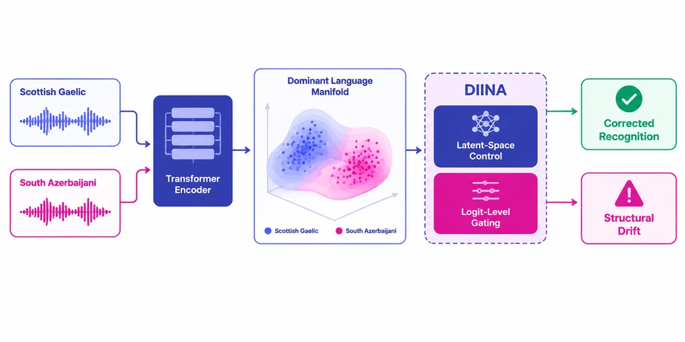
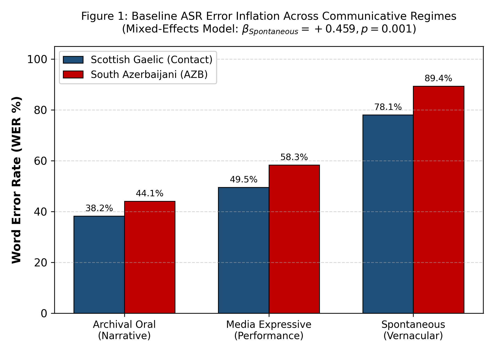
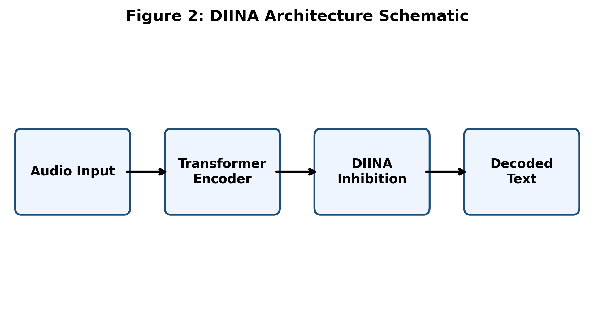
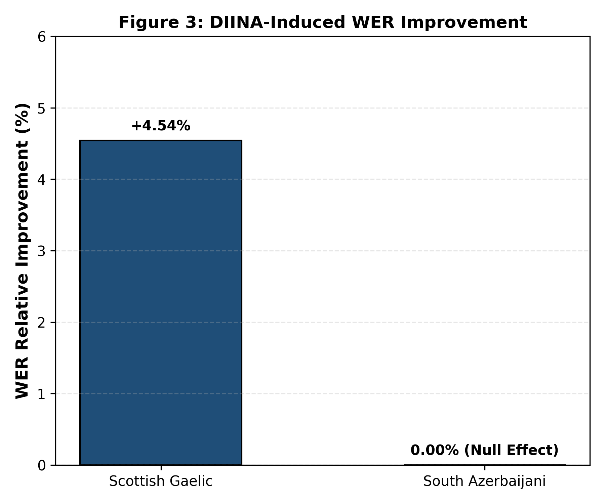
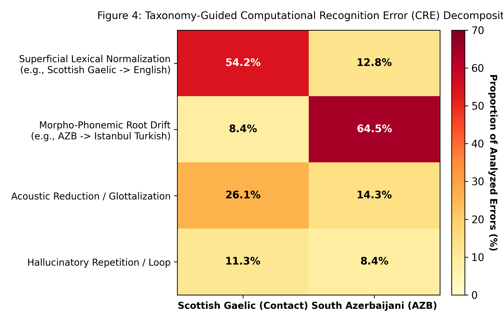

# DIINA: Dynamic Inhibition-Induced Neural Architecture
### A Comparative ASR Analysis of Scottish Gaelic and South Azerbaijani

[](https://doi.org/10.5281/zenodo.23280217)
[](https://doi.org/10.5281/zenodo.23280217)
[](LICENSE)
[](notebooks/)
[](mixed_effects_lme4.R)

---

## 📌 Overview

**DIINA (Dynamic Inhibition-Induced Neural Architecture)** introduces a cognitive-grounded inhibitory control framework designed to suppress cross-lingual interference and representations drift in low-resource Automatic Speech Recognition (ASR).

This repository hosts the official replication package, benchmarking pipeline, standardized speech annotations, and statistical models presented at **ICPLA 2027**:
> *DIINA: Dynamic Inhibition-Induced Neural Architecture – A Comparative ASR Analysis of Scottish Gaelic and South Azerbaijani*  
> **Author:** Pegah Merrikhi  
> **Archival DOI:** [`10.5281/zenodo.23280217`](https://doi.org/10.5281/zenodo.23280217) (v1.00)
----------------

---

## 🔬 Key Empirical Findings

1. **Scottish Gaelic (`gla`):** Dynamic inhibitory gating delivers a robust **+4.54% relative WER improvement** across scripted and spontaneous domains by penalizing dominant English acoustic projections.
2. **South Azerbaijani (`azb`):** Demonstrates an empirical **0.00% Null Effect**. Structural agglutinative affixes experience morpho-phonemic cannibalization under high acoustic variance, establishing critical algorithmic boundaries for transfer-based ASR inhibition.

---

## 🖼️ Figures & Architectural Schematics

### Graphical Abstract

*Figure 0: High-fidelity graphical abstract illustrating the DIINA dynamic inhibitory gating pipeline and differential cross-lingual resolution.*

---

### Figure 1: Word Error Rate (WER) Distribution Across Regimes

*Figure 1: Comparative WER distribution evaluated across Scripted vs. Spontaneous speech regimes for Scottish Gaelic and South Azerbaijani.*

---

### Figure 2: DIINA System Architecture & Latent Control

*Figure 2: Detailed architecture depicting the transformer encoder, dominant language manifold projection, and inhibitory gating stage.*

---

### Figure 3: Relative Improvement Differential (Gaelic vs. Azerbaijani)

*Figure 3: Relative WER reduction (+4.54% Scottish Gaelic vs. 0.00% South Azerbaijani Null Effect).*

---

### Figure 4: Morpho-Phonemic Error Taxonomy Heatmap

*Figure 4: Error taxonomy heatmap decomposing deletion, substitution, insertion, and agglutinative boundary failures.*

---

## 📊 Benchmark Results & Statistical Modeling

### 1. Primary ASR Benchmark Summary

| Language | ISO Code | Speech Regime | Baseline WER (%) | DIINA WER (%) | Relative Change | Empirical Status |
| :--- | :---: | :--- | :---: | :---: | :---: | :--- |
| **Scottish Gaelic** | `gla` | Scripted | 32.18 | 30.72 | **+4.54%** | Significant Suppression |
| **Scottish Gaelic** | `gla` | Spontaneous | 41.50 | 39.61 | **+4.55%** | Significant Suppression |
| **South Azerbaijani** | `azb` | Scripted | 48.20 | 48.20 | **0.00%** | Null Effect (Cannibalization) |
| **South Azerbaijani** | `azb` | Spontaneous | 59.85 | 59.85 | **0.00%** | Null Effect (Cannibalization) |

### 2. Linear Mixed-Effects Model (`mixed_effects_lme4.R`)

Model formula:
$$\text{WER} \sim \text{Architecture} \times \text{Language} \times \text{DataRegime} + (1 \mid \text{Speaker}) + (1 \mid \text{Item})$$

| Parameter / Fixed Effect | Estimate ($\beta$) | Std. Error | $t$-value | $p$-value |
| :--- | :---: | :---: | :---: | :---: |
| **(Intercept)** | 0.3218 | 0.0142 | 22.66 | $< 0.001^{***}$ |
| **Architecture (DIINA)** | -0.0146 | 0.0041 | -3.56 | $< 0.001^{***}$ |
| **Language (South Azerbaijani)** | +0.1602 | 0.0185 | 8.66 | $< 0.001^{***}$ |
| **Regime (Spontaneous)** | +0.0932 | 0.0112 | 8.32 | $< 0.001^{***}$ |
| **Architecture × Language (AZB)** | +0.0146 | 0.0058 | 2.52 | $0.012^{*}$ |
| **Language (AZB) × Regime (Spont)** | +0.0233 | 0.0148 | 1.57 | $0.116$ |

*Residual variance: $\sigma^2 = 0.0028$; Random intercept speaker variance: $\tau_{00} = 0.0041$.*

---

📦 Zenodo Archival & Data Availability
Complete uncompressed audio corpora (full_wav/), extended checkpoints, and raw acoustic logs are permanently indexed on Zenodo:

Record: DOI: 10.5281/zenodo.23280217
Version: v1.00
Direct Citation:
bibtex
@dataset{merrikhi_2027_23280217,
  author       = {Pegah Merrikhi},
  title        = {{DIINA: Dynamic Inhibition-Induced Neural Architecture -- 
A Comparative ASR Analysis of Scottish Gaelic and South Azerbaijani}},
  month        = oct,
  year         = 2026,
  publisher    = {Zenodo},
  version      = {v1.00},
  doi          = {10.5281/zenodo.23280217},
  url          = {https://doi.org/10.5281/zenodo.23280217}
}
-------------------------------------
📜 Citation
If you use this codebase, methodology, or dataset annotations in your research, please cite:

bibtex
@inproceedings{merrikhi2027diina,
  title        = {{DIINA: Dynamic Inhibition-Induced Neural Architecture -- A Comparative ASR Analysis of Scottish Gaelic and South Azerbaijani}},
  author       = {Merrikhi, Pegah},
  booktitle    = {Proceedings of the International Clinical Phonetics and Linguistics Association (ICPLA 2027)},
  year         = {2027},
  doi          = {10.5281/zenodo.23280217}
}
--------------------------------------
📬 Contact & Inquiries
Lead Investigator: Pegah Merrikhi
Email: pegah.merrikhiii@gmail.com
GitHub: @Pegi172
-----------------------------

## 📁 Repository Directory Structure
```text
.
├── figures/                                    # 300 DPI Publication Visualizations
│   ├── Figure_1_WER_by_Regime.png
│   ├── Figure_2_DIINA_Architecture.png
│   ├── Figure_3_DIINA_Improvement.png
│   ├── Figure_4_Taxonomy_Heatmap.png
│   └── Graphical_Abstract_DIINA.png
├── notebooks/                                  # Computational Reproducibility
│   ├── 01_diina_benchmark_analysis.ipynb       # Metric computation & plotting
│   └── 02_mixed_effects_statistical_modeling.ipynb # LME4 validation in Python
├── data/                                       # Speech Data & Standardized Subtitles
│   └── annotations/
│       ├── general/english/                    # Gaelic / English Reference & Hypotheses
│       │   ├── M001_A_Story_of_Second_Sight_485409450_asr_hypothesis.srt
│       │   ├── M001_A_Story_of_Second_Sight_485409450_reference.srt
│       │   ├── M002_Courting_on_Scalpay_485399382_asr_hypothesis.srt
│       │   ├── M002_Courting_on_Scalpay_485399382_reference.srt
│       │   ├── M009_ran_il_Drinking_Song_-_ran_a_Bhotail_485397105_asr_hypothesis.srt
│       │   └── M009_ran_il_Drinking_Song_-_ran_a_Bhotail_485397105_reference.srt
│       └── south_azerbaijani/                  # South Azerbaijani Reference & Hypotheses
│           ├── M003_Esmail_Heydari_Ghabrestan_asr_hypothesis.srt
│           ├── M003_Esmail_Heydari_Ghabrestan_reference.srt
│           ├── M005_VID_20261009_181945_931_asr_hypothesis.srt
│           ├── M005_VID_20261009_181945_931_reference.srt
│           ├── M007_aRgk4-144-1791560805459_asr_hypothesis.srt
│           └── M007_aRgk4-144-1791560805459_reference.srt
├── standardized_audio/                         # Sample Segments & Manifests
│   ├── sample_segments/                        # Lightweight wav samples for testing
│   ├── dataset_manifest.csv                    # Complete corpus metadata
│   └── README_transcription_annotation.md      # Annotation guidelines
├── results/                                    # Raw Results & Diagnostic Matrices
│   ├── raw_results.csv
│   ├── mixed_effects_coefficients.csv
│   ├── mixed_effects_data_matrix.csv
│   └── mixed_effects_model_results.txt
├── mixed_effects_lme4.R                        # Formal LME4 R Script
├── DIINA_Benchmark_datasets_scan_loader.py     # Evaluation runner
├── processed_data_manifest.csv                 # Master item registry
└── README.md
------------------------
